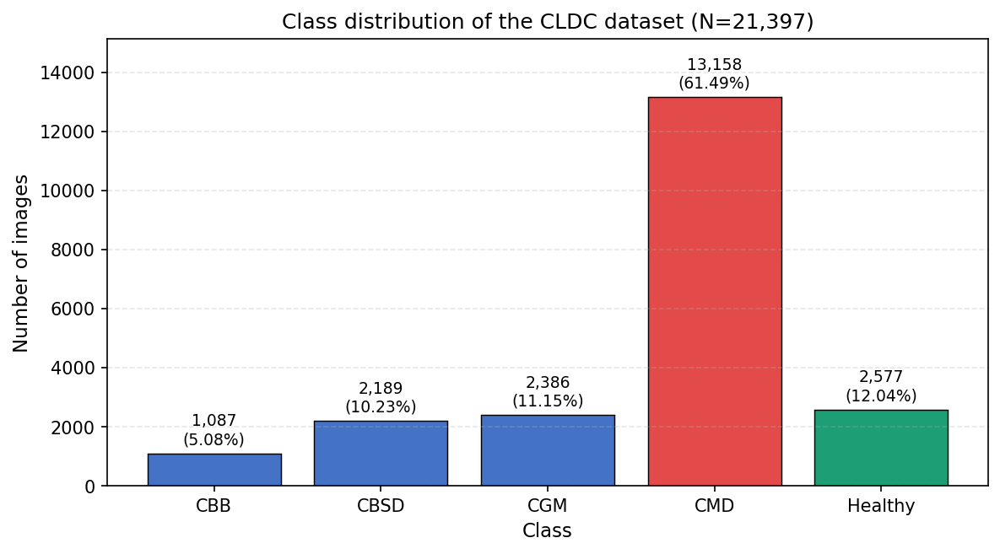
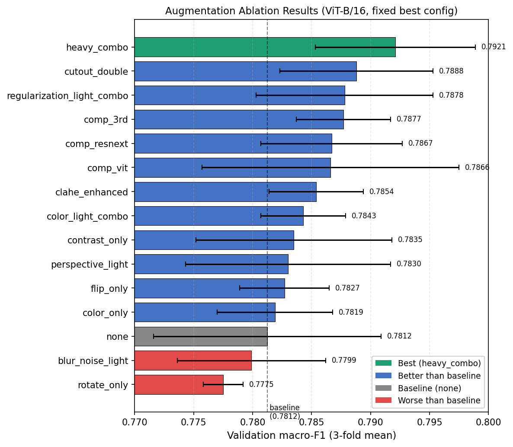

# Cassava Leaf Disease Classification: Classical ML vs. CNNs vs. Vision Transformer

| | |
|---|---|
| **Course** | CS523 – Computer Vision, Özyeğin University (M.Sc. Computer Engineering), Spring 2026 · Instructor: Prof. Dr. Çiğdem Eroğlu Erdem |
| **Type** | Team project · repository maintained by Ali Baki Türköz |
| **Deliverable** | IEEE-style paper (not included in this repository) + this source code |
| **Best result** | ViT-B/16 + `heavy_combo` augmentation: **macro-F1 0.7921 ± 0.0068**, **accuracy 0.8855 ± 0.0040** (3-fold stratified CV) |

## Problem
Classify cassava leaf photos into five classes: Cassava Bacterial Blight (CBB), Cassava Brown Streak Disease (CBSD), Cassava Green Mottle (CGM), Cassava Mosaic Disease (CMD) and Healthy. The symptoms look alike and the images are taken in the field, so the task is hard.

## Data
- **Source:** public Kaggle *Cassava Leaf Disease Classification* (CLDC) competition data, 21,397 labelled images. It is not included here; download it from Kaggle.
- **Imbalance:** CMD is 61.49 % of the images and CBB only 5.08 % (about 12 : 1).



## Method
| Step | Details |
|---|---|
| Evaluation | 3-fold stratified cross-validation, seed 42; mean ± std over folds. Primary metric: macro-F1 (accuracy is dominated by CMD). |
| Classical baselines | Grayscale 64×64 → flatten → StandardScaler → PCA (95 % variance) → SGD classifier / logistic regression / Extra Trees / Random Forest |
| Deep models | ResNet-50 and EfficientNet-B4 at 224×224, ViT-B/16 at 384×384; ImageNet-pretrained, full fine-tuning |
| Training | AMP mixed precision, up to 200 epochs, early stopping on val loss (patience 20), gradient clipping 1.0, deterministic settings |
| Phase 1 – hyperparameter search (`main.py`) | Optuna, TPE sampler + median pruner, categorical space: learning rate, weight decay, batch size, loss (CE / label-smoothed CE / focal), optimizer (AdamW / Adam / SGD-Nesterov), scheduler (plateau / cosine / cosine warm restarts), class weighting on/off |
| Phase 2 – augmentation ablation (`augmentation_ablation.py`) | The selected ViT-B/16 configuration is held fixed and retrained with each augmentation policy |

Selected Phase-1 configuration: ViT-B/16, lr 5e-4, weight decay 1e-3, batch 16, cross-entropy, no class weights, SGD-Nesterov (momentum 0.95), ReduceLROnPlateau.

## Results
**Model comparison (Phase 1, best trial per family, no augmentation)**

| Model | Macro-F1 | Accuracy |
|---|---|---|
| Best classical baseline (SGD classifier) | 0.2012 ± 0.0064 | 0.3088 ± 0.0145 |
| EfficientNet-B4 | 0.7274 ± 0.0123 | 0.8494 ± 0.0059 |
| ResNet-50 | 0.7405 ± 0.0169 | 0.8521 ± 0.0085 |
| ViT-B/16 | 0.7803 ± 0.0105 | 0.8792 ± 0.0069 |

**Augmentation ablation (Phase 2, top 3 of 15 reported policies)**

| Policy | Macro-F1 | Accuracy | ΔF1 vs. `none` |
|---|---|---|---|
| `heavy_combo` | **0.7921 ± 0.0068** | **0.8855 ± 0.0040** | +0.0109 |
| `cutout_double` | 0.7888 ± 0.0065 | 0.8835 ± 0.0031 | +0.0075 |
| `regularization_light_combo` | 0.7878 ± 0.0075 | 0.8843 ± 0.0048 | +0.0065 |
| `none` (baseline) | 0.7812 ± 0.0096 | 0.8800 ± 0.0063 | — |



**Interpretation**
- ViT-B/16 beat both CNNs by about +0.04 macro-F1. The two CNNs were close; EfficientNet-B4 did not beat ResNet-50 at this search budget.
- Raw-pixel classical models are not competitive. Extra Trees and Random Forest only predicted the majority class (accuracy 0.6149 = CMD share).
- Augmentation adds a small gain (+0.011 macro-F1). The largest per-class gain (+0.028 F1) is on the rarest class, CBB.
- Most top trials used no class weighting, and the best ViT runs used SGD rather than AdamW.

**Limitations**
- There is no separate held-out test set. All numbers are out-of-fold validation scores, and model and augmentation selection used the same folds, so the numbers are somewhat optimistic.
- The augmentation ranking was measured only on one ViT-B/16 configuration.
- Input resolution differs (224 vs. 384), so part of the ViT advantage may come from the higher resolution.
- This is a controlled single-model study (no ensembling, TTA or pseudo-labelling), so it is below Kaggle leaderboard ensembles.

Full details, per-class analysis and the comparison with public Kaggle solutions are in the course paper (Sections IV–V). The paper is not included in this repository.

## Earlier work
This project follows up an earlier B.Sc. project on the same problem: a CNN trained from scratch in EE470 at Yeditepe University (2024), which reached 55 % accuracy on a balanced 5-class subset. Repository: [Cassava-Plant-Disease-Classification-Project-EE470](https://github.com/AliBaki-Turkoz/Cassava-Plant-Disease-Classification-Project-EE470).

## Repository structure
```
main.py                   # Phase 1: EDA, classical baselines, Optuna search for deep models
models.py                 # Model builders, losses (CE, focal, bi-tempered), optimizers, schedulers, transforms
augmentation_ablation.py  # Phase 2: augmentation ablation on the fixed best configuration
requirements.txt
paper/fig/                # Figures from the paper (results, confusion matrices, curves, sample images)
```

## Running
1. Install dependencies: `pip install -r requirements.txt`. A CUDA GPU is strongly recommended.
2. Download the Kaggle CLDC data into `data/` (`train.csv`, `train_images/`, `label_num_to_disease_map.json`), or set `CASSAVA_DATA_DIR=/path/to/data`.
3. Phase 1:
   - `python main.py --dry-run` lists the search space.
   - `python main.py --classical` runs the classical baselines.
   - `python main.py --deep` runs the Optuna search.
   - Set `MODEL_TYPES` at the top of `main.py` to `["ML"]`, `["DL"]` or `["ML", "DL"]`. It is `["ML"]` as committed, so `--deep` needs `"DL"` added. The number of trials is `OPTUNA_N_TRIALS`.
4. Phase 2: put the best Phase-1 values in the `BEST_*` block of `augmentation_ablation.py` (pre-filled with the configuration above), then run one of:
   - `python augmentation_ablation.py --reported`: the 15 policies reported in the paper.
   - `python augmentation_ablation.py`: all 22 defined policies.
   - `python augmentation_ablation.py --aug heavy_combo,none`: selected policies only.

Outputs (CSV logs, confusion matrices, curves, reports) are written to `data/Results/`, `results_aug/` and `checkpoints*/`. They are git-ignored.

## Notes and known issues
- **Code is kept as submitted,** with these changes only:
  - hard-coded machine paths were replaced by `data/` / `CASSAVA_DATA_DIR`;
  - the two original augmentation sweep scripts, which differed only in their policy list and output folder, were merged into `augmentation_ablation.py`.
- **22 policies are defined, 15 are reported.** `augmentation_ablation.py` defines 22 augmentation policies, but results for only 15 are reported in the paper (`REPORTED_IN_PAPER` in the script). It is not known whether the other 7 were run (`geometric_only`, `erasing_only`, `brightness_only`, `light_combo`, `medium_combo`, `safe_light_combo`, `geo_light_combo`), so no results are claimed for them.
- **Raw logs are not available.** The original run logs (Optuna trial CSVs) were not preserved, so the numbers above come from the paper. Re-running gives comparable but not necessarily identical values, because GPU nondeterminism remains even with deterministic settings.
- **Trial count.** The Optuna trials reported in the paper were collected over several runs; `OPTUNA_N_TRIALS` is set per run.
- **Comments are in Turkish.**
- **No trained weights are included.**

## Academic integrity
This repository documents coursework for portfolio purposes. It is not intended as a solution to copy for the same course.

## License
The code in this repository is released under the [MIT License](LICENSE) (copyright the project team). Datasets, pretrained weights and third-party material keep their own licences and terms of use; they are not covered by this licence.
